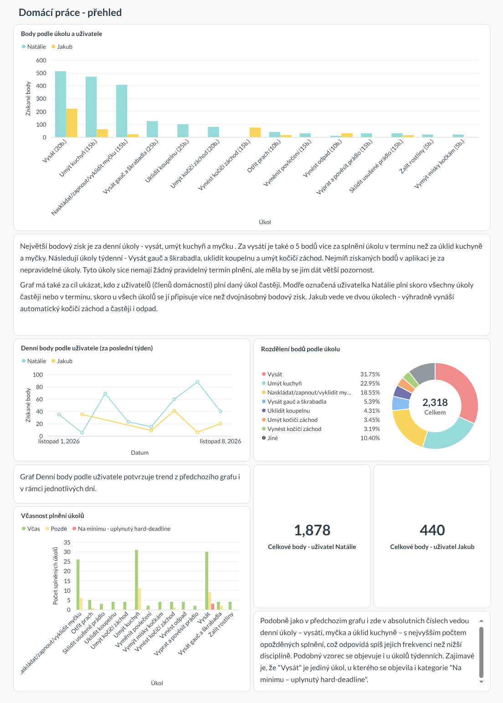
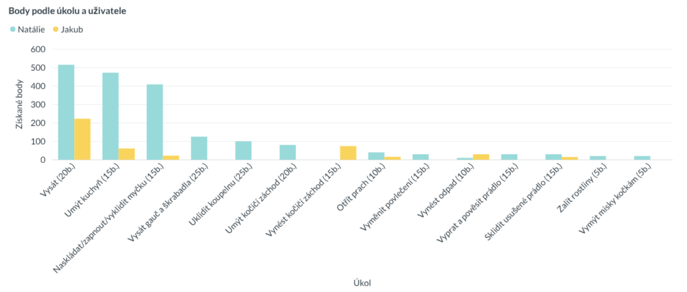
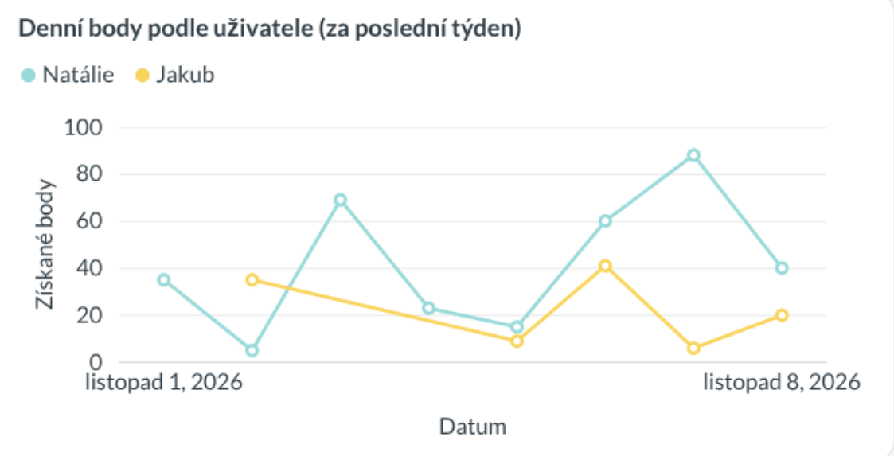
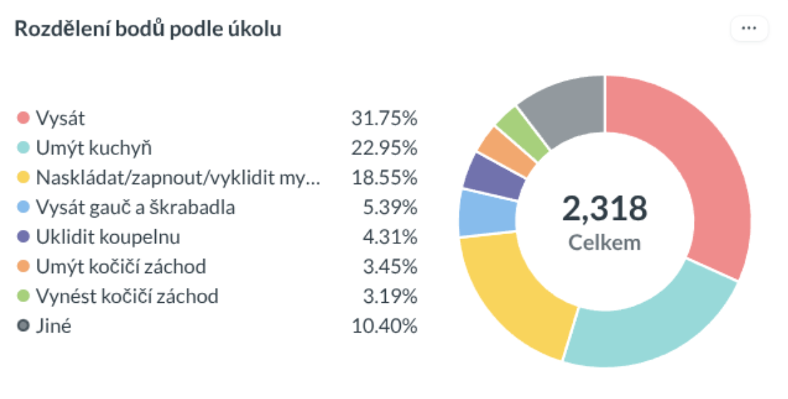
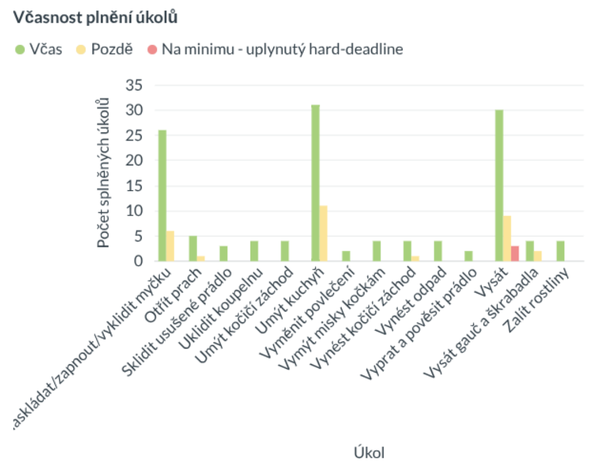
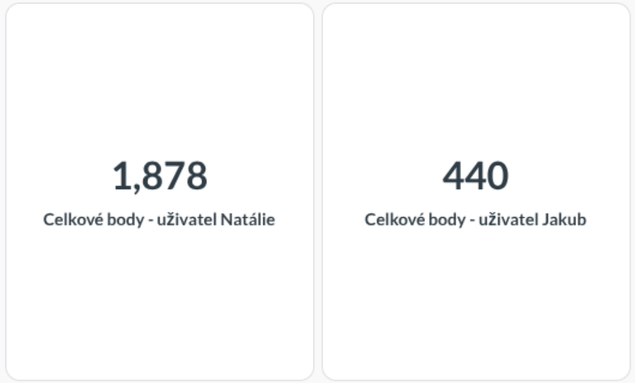

# Domácí práce – analýza dat

Gamifikovaná aplikace na rozdělení domácích prací mezi dva uživatele. Data v tomto
reportu pokrývají období **28. 9. 2026 – 8. 11. 2026** (synteticky vygenerovaná
historie plnění úkolů) a analýza/vizualizace byla vytvořena v Metabase nad
Postgres databází.


---

## 1. Body podle úkolu a uživatele

```sql
-- 
SELECT u.name  AS user_name, t.name || ' (' || t.base_points::int || 'b.)' AS task_name, SUM(s.received_points) AS total_points FROM scoring AS s
LEFT JOIN users AS u ON s.user_id=u.user_id
LEFT JOIN tasks AS t ON s.task_id = t.task_id
GROUP BY u.name, t.name, t.base_points
ORDER BY SUM(s.received_points) DESC
```



Největší bodový zisk je za denní úkoly - vysát, umýt kuchyň a myčku. Za vysátí je
také o 5 bodů více za splnění úkolu v termínu než za úklid kuchyně a myčky.
Následují úkoly týdenní - Vysát gauč a škrabadla, uklidit koupelnu a umýt kočičí
záchod. Nejmíň získaných bodů v aplikaci je za nepravidelné úkoly. Tyto úkoly sice
nemají žádný pravidelný termín plnění, ale měla by se jim dát větší pozornost.

Graf má také za cíl ukázat, kdo z uživatelů (členů domácnosti) plní daný úkol
častěji. Uživatelka Natálie plní skoro všechny úkoly častěji nebo v termínu, skoro
u všech úkolů se jí připisuje více než dvojnásobný bodový zisk. Jakub vede ve dvou
úkolech - výhradně vynáší automaticky kočičí záchod a častěji i odpad.

---

## 2. Denní body podle uživatele (za poslední týden)

```sql
-- 
SELECT u.name AS user_name, SUM(s.received_points) AS daily_points,CAST(s.completed_at AS date) AS day_ FROM scoring AS s 
LEFT JOIN users AS u ON s.user_id = u.user_id
WHERE CAST(s.completed_at AS date) >= (SELECT MAX(CAST(completed_at AS date)) FROM scoring) - INTERVAL '7 days'
GROUP BY u.name, day_
ORDER BY day_ ASC
```



Graf potvrzuje trend z předchozího grafu i v rámci jednotlivých dní.

---

## 3. Rozdělení bodů podle úkolu

```sql
--
SELECT t.name AS task_name, SUM(s.received_points) AS points  FROM scoring AS s
LEFT JOIN tasks AS t ON s.task_id = t.task_id
GROUP BY t.name 
ORDER BY points DESC
```



---

## 4. Včasnost plnění úkolů

```sql
-- 
SELECT t.name AS jmeno_ukolu, COUNT(s.received_points) AS pocet_splnenych_ukolu,
CASE 
WHEN (s.received_points::NUMERIC/t.base_points::NUMERIC)>=1 THEN 'Včas'
WHEN (s.received_points::NUMERIC/t.base_points::NUMERIC)>0.25 AND (s.received_points::NUMERIC/t.base_points::NUMERIC)<1 THEN 'Pozdě'
ELSE 'Na minimu - uplynutý hard-deadline'
END AS Splněno FROM scoring AS s 
LEFT JOIN tasks AS t ON s.task_id=t.task_id
LEFT JOIN users AS u ON s.user_id = u.user_id
GROUP BY t.name, Splněno
ORDER BY jmeno_ukolu ASC, Splněno DESC
```



Podobně jako v předchozím grafu i zde v absolutních číslech vedou denní úkoly –
vysátí, myčka a úklid kuchyně – s nejvyšším počtem opožděných splnění, což
odpovídá spíš jejich frekvenci než nižší disciplíně plnění. Podobný vzorec se objevuje i
u úkolů týdenních. Zajímavé je, že "Vysát" je jediný úkol, u kterého se objevila i
kategorie "Na minimu – uplynutý hard-deadline".

**Poznámka k limitům analýzy:** graf ukazuje absolutní počty, ne procenta. Úkol s
vysokou frekvencí bude mít přirozeně víc opožděných případů i při nízké
chybovosti, zatímco zřídka prováděný úkol s vysokou chybovostí může v grafu
vypadat nenápadně. Pro posouzení skutečné spolehlivosti plnění jednotlivých úkolů
by bylo potřeba počet pozdních splnění vydělit celkovým počtem splnění daného
úkolu. U zřídka prováděných úkolů (nepravidelné, měsíční) je navíc vzorek dat tak malý, že by
takové procento bylo stále dost nejisté.

---

## 5. Celkové body

```sql
-- 
SELECT u.name AS jmeno_uzivatele, SUM(s.received_points) FROM scoring AS s 
LEFT JOIN users AS u ON s.user_id = u.user_id
WHERE u.name = 'Natálie' -- pro Jakuba změň na 'Jakub'
GROUP BY u.name
ORDER BY u.name ASC
```



- Natálie: 1 878 b.
- Jakub: 440 b.
