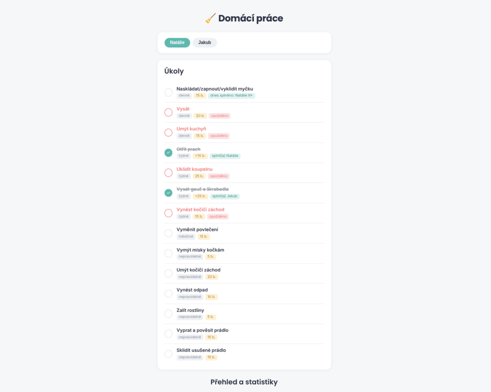
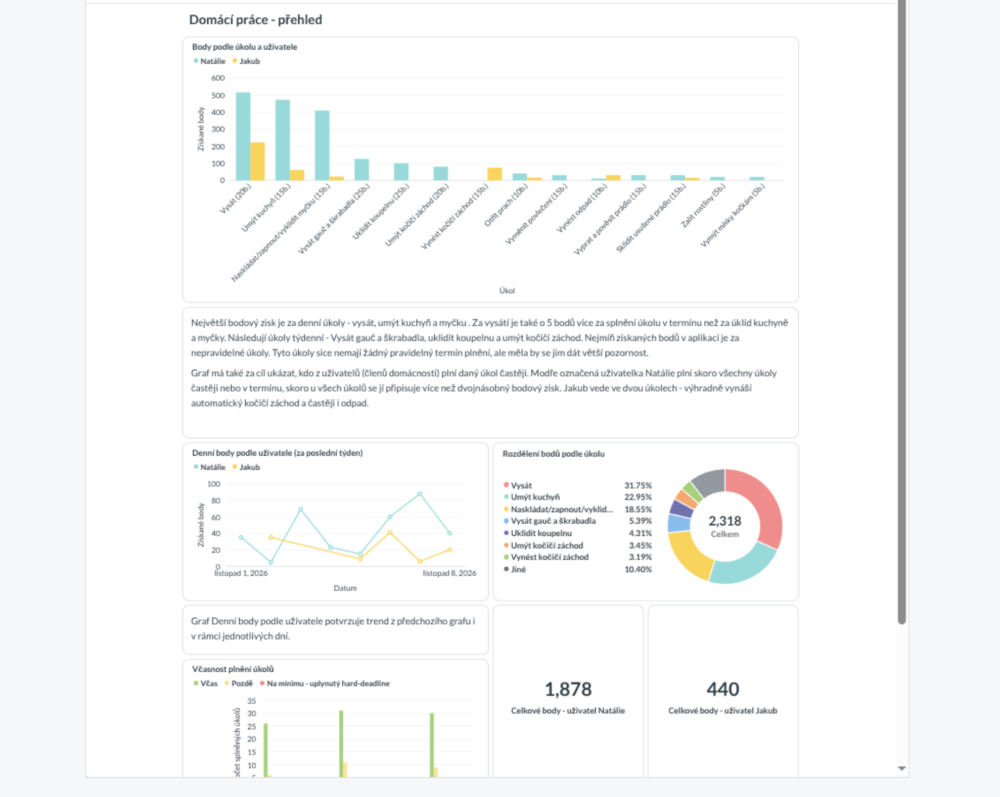
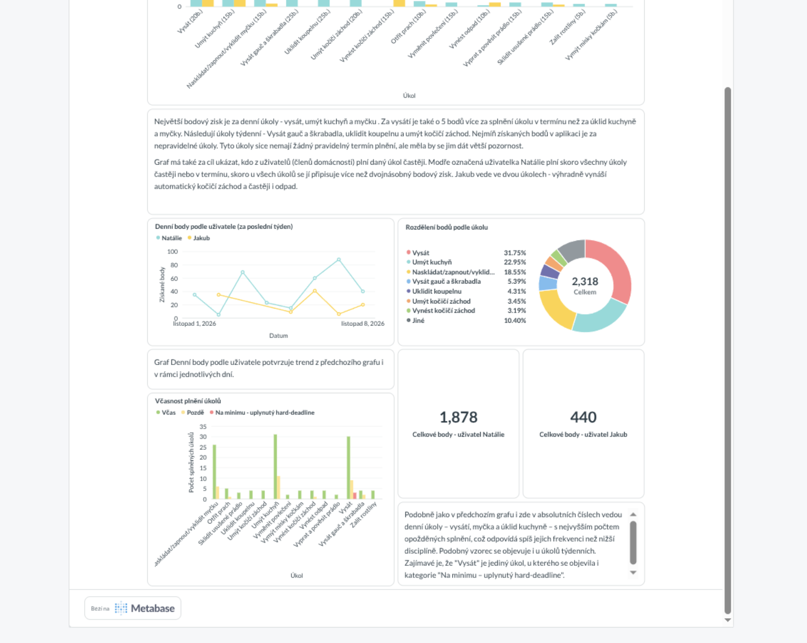

# Domácí práce

> **EN summary:** A gamified household-chores app for two users, built with FastAPI,
> Postgres and a plain JavaScript frontend (no framework). Completing a task awards points based on its
> priority and how close to (or past) the deadline it was completed, calculated by a
> separate scoring microservice. Usage data is visualized in a Metabase dashboard -
> see [ANALYSIS.md](ANALYSIS.md) for the full data analysis with SQL queries and insights.

Gamifikovaná aplikace na rozdělení domácích prací mezi dva uživatele. Za splnění úkolu
se přidělují body podle priority úkolu a toho, jak blízko (nebo daleko) k termínu byl
splněn.

## Proč aplikace vznikla

Aplikace domácí práce vznikla, abychom si s přítelem rozdělovali domácí práce rovnoměrněji. Pro něj
byla motivací hlavně gamifikace a možnost vidět vykonanou práci reálně znázorněnou v grafech. 
Pro mě to byl zároveň praktický projekt - Python a SQL jsem si do té doby procvičovala 
hlavně na menších cvičných příkladech, a chtěla jsem si je vyzkoušet na rozsáhlejším projektu,
který je blíž tomu, jak datová analytika vypadá v praxi.

## Vzhled webové aplikace

Po otevření aplikace je možné přepínat mezi dvěma uživateli domácnosti. Úkoly mají
předem stanovené intervaly plnění - denní, týdenní, měsíční nebo nepravidelné (tyto úkoly
se plní dle potřeby). U každého úkolu je vidět počet bodů za jeho splnění v termínu = 
plný počet bodů/base_points. Při pozdějším splnění počet obdržených bodů klesá. Červeně
označené úkoly jsou opožděné a měly by se plnit přednostně - u těch uživatel obdrží
minimálně 25 % bodů, pokud už uplynul i tzv. hard deadline (po uplynutí běžného
deadlinu bodová hodnota klesá lineárně až k minimu 25 % při dosažení hard deadlinu).

Skórovací mechanismus počítá i s bonusem za splnění úkolu v termínu u úkolů označených jako
urgentní (+20 % bodů) - v současném seznamu úkolů ale žádný takto označený není,
tento bonus se v datech zatím neprojevuje.

Většina úkolů (např. "Otřít prach" - splnila Natálie, "Vysát gauč a škrabadla" -
splnil Jakub) může být v daném období splněna jen jednou. Kdo úkol splní první, získá
body, druhému se úkol znovu nenabídne jako aktivní. Výjimkou je úkol "Naskládat/
zapnout/vyklidit myčku" a nepravidelné úkoly, které může kterýkoliv z uživatelů
splnit opakovaně a nezávisle na druhém.

Barevné rozlišení odpovídá stavu úkolu na první pohled - tyrkysová barva značí splněno, 
žlutá bodovou hodnotu a korálová opožděný úkol.

Dashboard výše je postavený na syntetických datech k 8.- 9.11.2026. Aplikace v tu
dobu ještě neměla dostatek reálných dat. S přítelem máme v plánu aplikaci běžně používat, 
postupně se budou objevovat i reálná data.

## Stack

- **FastAPI** + **Postgres** - dvě oddělené databáze (`tasks` pro úkoly/uživatele,
  `chores` pro scoring), každá ve svém Docker kontejneru
- **python/** - scoring mikroslužba, počítá a ukládá body za splněné úkoly
- **backend/** - API pro úkoly a uživatele, poskytuje frontend
- **frontend/** - jednoduchý JS/HTML/CSS checklist bez frameworku
- **Metabase** - vizualizace a analýza nasbíraných dat

## Jak spustit

1. `docker compose up -d` (v rootu repa) - nastartuje obě databáze a Metabase
2. V `python/`: `uv sync` a `uv run fastapi dev main.py` (scoring služba, port 8000)
3. V `backend/`: `uv sync` a `uv run fastapi dev main.py --port 8001` (backend + frontend)
4. Otevři http://127.0.0.1:8001

Detaily k jednotlivým částem: [backend/readme.md](backend/readme.md),
[python/readme.md](python/readme.md).

## Datová analýza

Detailní analýza nasbíraných dat (SQL dotazy, grafy z Metabase, komentáře) je v
[ANALYSIS.md](ANALYSIS.md).

## Poznámka k vývoji

Scoringová služba (`python/`, včetně jejího API) a celá datová analýza (SQL dotazy,
Metabase dashboard, `ANALYSIS.md`) byly vytvořeny mnou. API a backend pro úkoly a
uživatele (`backend/`) a frontend aplikace vznikly s pomocí AI pair-programmingu (Claude).